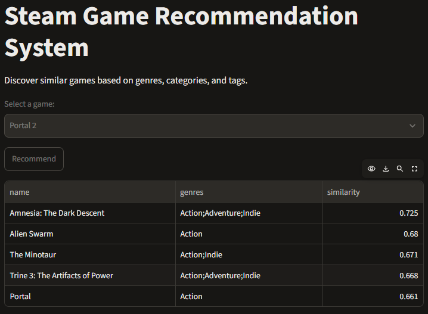

# Steam Game Recommendation System

A **content-based video game recommendation system** built using Python, TF-IDF vectorisation, and cosine similarity.

The application recommends similar Steam games based on their genres, categories, and user-defined tags. A Streamlit interface allows users to select a game and receive five recommendations.

## 1. Project Overview

The objective of this project is to explore how content-based filtering can be used to recommend video games based on shared characteristics.

Rather than relying on user ratings or historical interactions, the system compares games using their descriptive features.

**Project objectives:**
- Explore and preprocess a Steam games dataset.
- Develop a content-based recommendation algorithm.
- Apply TF-IDF vectorisation and cosine similarity.
- Compare different feature configurations.
- Build an interactive recommendation interface using Streamlit.

## 2. Technologies Used

| Technology | Purpose |
|---|---|
| Python | Application development |
| Pandas | Data exploration and preprocessing |
| Scikit-learn | TF-IDF vectorisation and cosine similarity |
| Jupyter Notebook | Data analysis and model experimentation |
| Streamlit | Interactive web application |

**Dataset:** [Steam Store Games — Kaggle](https://www.kaggle.com/datasets/nikdavis/steam-store-games)

The dataset contains 27,075 games and includes information such as genres, categories, SteamSpy tags, and game descriptions.

## 3. Methodology

### Data Preprocessing

The following features were selected:

- `appid` — Unique game identifier
- `name` — Game title
- `genres` — General game classifications
- `categories` — Gameplay characteristics
- `steamspy_tags` — Community-generated game tags

Duplicate game IDs were removed, missing descriptive values were handled, and the selected characteristics were combined into a single text representation for each game.

### TF-IDF Vectorisation

The combined features were converted into numerical vectors using Scikit-learn's `TfidfVectorizer`.

TF-IDF assigns weights to terms based on their frequency within a game description and their rarity across the dataset.

This allows the recommendation system to compare games according to their distinguishing characteristics.

### Cosine Similarity

Cosine similarity was used to measure the similarity between game vectors.

When a user selects a game, the system calculates its similarity against the other games in the dataset and returns the five closest matches, excluding the selected game.

Rather than generating a full pairwise similarity matrix, similarity scores are calculated only for the selected game to reduce memory usage.

## 4. Model Comparison

Two content-based recommendation approaches were explored.

| Model | Features |
|---|---|
| Model 1 — Baseline | Genres, categories, SteamSpy tags |
| Model 2 — Extended | Baseline features + short game descriptions |

Both models used TF-IDF vectorisation and cosine similarity.

### Findings

The models were compared qualitatively using games such as *Portal 2* and *Left 4 Dead 2*.

For *Portal 2*, the baseline model recommended *Portal* among its top five results, while the extended model did not.

For *Left 4 Dead 2*, both models returned several relevant titles, including *Left 4 Dead* and *Killing Floor*.

These observations suggest that incorporating additional descriptive text does not necessarily improve recommendation relevance. Generic wording and overlapping descriptions may introduce noise into the feature representation.

**Final decision:** The baseline model was retained due to its simplicity, interpretability, and reasonable initial results.

The comparison was qualitative and limited to a small number of games; it does not establish overall model superiority.

## 5. Streamlit Application

A simple Streamlit application was developed to demonstrate the recommendation system.

Users can:

1. Select a Steam game from a dropdown menu.
2. Click the **Recommend** button.
3. View five recommended games with their genres and cosine similarity scores.

The application uses the baseline TF-IDF model to generate recommendations dynamically.

## 6. Project Structure

```text
steam-game-recommender/
├── data/
│   ├── steam.csv
│   └── steam_description_data.csv
├── notebooks/
│   ├── 01_data_exploration.ipynb
│   └── 02_recommendation_model.ipynb
├── app.py
├── requirements.txt
└── README.md
```

**Notebook descriptions:**

- `01_data_exploration.ipynb` — Data exploration, cleaning, and feature engineering.
- `02_recommendation_model.ipynb` — TF-IDF vectorisation, recommendation algorithm, and model comparison.
- `app.py` — Streamlit application.

## 7. Installation and Usage

**Requirements:** Python 3.11 or compatible Python version.

Clone the repository:

```bash
git clone https://github.com/jaswongn/data_science_projects.git
cd data_science_projects/steam-game-recommender
```

Install dependencies:

```bash
python -m pip install -r requirements.txt
```

Download the Steam Store Games dataset and place `steam.csv` inside the `data/` directory. The modelling notebook also requires `steam_description_data.csv`.

Launch the Streamlit application:

```bash
python -m streamlit run app.py
```

Open the local address displayed by Streamlit, typically `http://localhost:8501`.

## 8. Limitations and Future Improvements

The current recommendation system has several limitations:

- **Feature dependence:** Recommendations are based on genres, categories, and tags rather than actual gameplay experiences.
- **Limited personalisation:** The system does not use individual user preferences or interaction histories.
- **Feature ambiguity:** Games with similar tags may have substantially different gameplay.
- **Limited evaluation:** Recommendation quality was assessed through a small number of qualitative examples rather than a comprehensive benchmark.
- **Historical dataset:** Recommendations are limited to games and metadata available in the dataset.

Potential future improvements include incorporating user interaction data for collaborative filtering, experimenting with different feature weights, and evaluating recommendations using a larger test set.

## 9. Conclusion

This project demonstrates the implementation of a content-based recommendation system using TF-IDF and cosine similarity.

It provided practical experience in data preprocessing, feature engineering, recommendation algorithms, qualitative model comparison, and application development with Streamlit.

The project serves as a foundational exploration of recommendation systems and can be extended with more advanced approaches in the future.

### Application Screenshot

